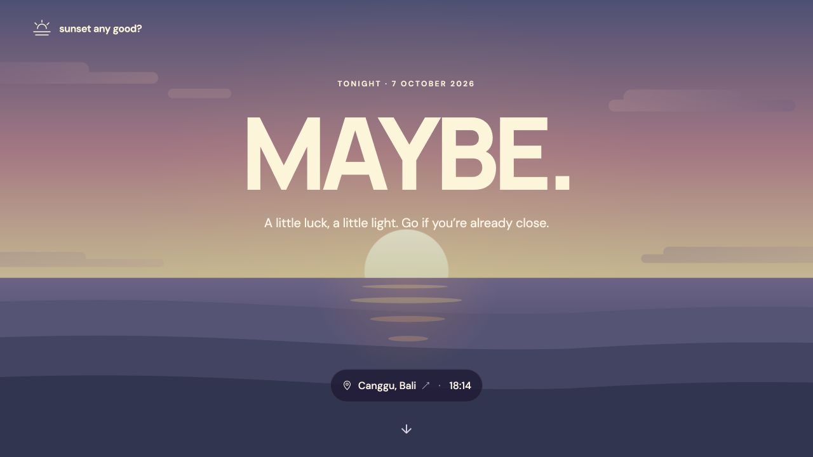

# sunset any good?

**Should you head to the beach?** One sky. One answer.

[Try the live site →](https://sunsetanygood.web.app)



**SKIP · MAYBE · GO · FUCK YES**

A minimal sunset forecast with a sky that changes with the weather. Start in Canggu, Bali, or use your location. Scroll for the six inputs and the score calculation. Rate the sky from one hour before sunset; until then, a countdown shows when voting opens.

## Run locally

Requires Python 3. Node.js is used for the scripts and tests. No build step or frontend dependencies.

```sh
cp firebase-config.example.js dist/firebase-config.js
npm start
```

Open **http://127.0.0.1:4173**. Weather works without API keys. To save votes, fill in your Firebase Web app configuration, enable anonymous Auth and Firestore, and deploy `firestore.rules`. Working configuration and credentials are excluded from Git.

## How it works

Vanilla HTML, CSS and JavaScript; a responsive animated canvas. [Open-Meteo](https://open-meteo.com/) supplies cloud layers, visibility, sunset time and CAMS aerosol data. Three samples toward the setting sun approximate the light corridor. Feedback uses Firebase Hosting, anonymous Auth and Firestore.

The **0–100 score is an experimental heuristic**, not a standard or a probability. Votes help evaluate it; cloud thickness and full sunlight geometry are not modeled.

Optional Google Analytics counts visits and `sunset_feedback_saved` events (`matched` / `different`). Set `measurementId` in your local Firebase config to enable it on HTTPS after the visitor chooses Allow; localhost is excluded. Vote events omit coordinates, weather and Firebase UIDs. The 180-day choice can be changed in Analytics settings; Decline stops collection and clears Analytics cookies. [Privacy policy](https://sunsetanygood.web.app/privacy.html).

## Checks

```sh
npm test
```

Tests cover weather parsing, geocoding, score contributions, voting boundaries and local midnight. Firestore access checks and their setup are in [`tests/firestore`](tests/firestore). Before deploying a fork, select your own Firebase project and change the Hosting site in `firebase.json`.
